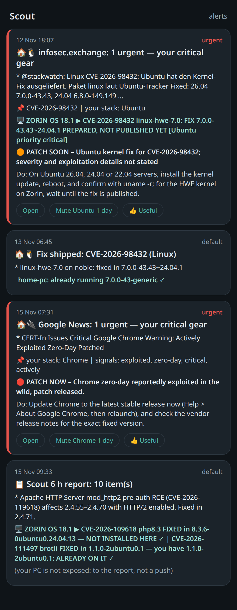

# Scout

**A passive threat-intelligence watcher for one person's own gear.** Scout reads about 76 public security sources
around the clock, keeps only what touches the products you actually run, checks it against your own machine, and
pushes a short, plain-language alert to your phone.

It is a single Python file, runs as a small systemd service on a home PC, and has an optional free twin on GitHub
Actions that takes over when the PC is off.

<p align="center"></p>

> _Text from real Scout alerts of November 2026, shortened and rendered as cards for this page. The host name was replaced._

## Why it exists

Security news is not short of volume. It is short of relevance and timing. A serious flaw is usually public for
days before a fix reaches a given machine, and in that window the useful questions are narrow:

1. **Does this touch something I run?**
2. **Is my own machine exposed right now, or already on the fix?**
3. **What do I do today: patch, apply a workaround, or wait?**

Advisories, mailing lists, vendor feeds and social posts each answer a part of that, late and for everyone at
once. Scout was built to answer all three for one person's gear, early, on a phone, in a few lines.

It is a defensive tool and stays inside clear limits:

- It **only reads public feeds and public APIs**. It never scans, probes, or connects to anyone's systems.
- It does not download or run exploit code. Proof-of-concept repositories are noted by name and link only.
- The only machine it inspects is the one it runs on (installed package versions, running kernel), read-only.
- It opens no port. The buttons on an alert work through a private notification topic that Scout polls.
- It tells you what to do and leaves the doing to you. It installs nothing and changes no setting.

## What it does

- **Two lanes.** Early sources (CISA KEV, oss-security, Mastodon, vendor advisories, Google News, …) every 20
  minutes; everything else every 6 hours.
- **Your products, two tiers.** A `critical` list wakes you at once when an attack word sits next to the product;
  everything else on your keyword list lands in one 6-hour report.
- **"What does it mean for my PC?"** For Linux items Scout asks Ubuntu's CVE tracker and compares with what is
  installed here:

  ```
  🖥 ZORIN OS 18.1 ▶ CVE-… linux-hwe-7.0 FIX 7.0.0-43 IS OUT — you run 7.0.0-42: UPDATE + REBOOT NOW
  🖥 ZORIN OS 18.1 ▶ CVE-… openssl FIXED in 3.0.13-0ubuntu3.2 — you have 3.0.13-0ubuntu3.16: ALREADY ON IT ✓
  🖥 ZORIN OS 18.1 ▶ CVE-… nginx FIXED in 1.24.0-2ubuntu7.19 — NOT INSTALLED HERE ✓
  ```

- **Fix tracker.** An open CVE on your PC is followed until the fix ships ("Fix shipped") and until you run it
  ("Closed").
- **Confirmed within the hour.** The same CVE from two independent sources is flagged as confirmed.
- **Noise control.** One story per product per day, old CVEs and look-alike matches go to the report, muted
  accounts, a per-product mute button on every alert. Nothing is thrown away: what is held back is in the report
  with the reason.
- **Optional AI analyst.** With a Claude API key each alert gets a verdict (🔴 PATCH NOW / 🟠 PATCH SOON / 🟡 WATCH /
  ⚪ FYI) and three lines of briefing, plus a morning brief, an evening brief and a weekly letter. Without a key
  Scout still works and alerts carry the essentials (CVE ids, CVSS, your products, attack words, versions).
- **Self-watch.** Heartbeat file, start report, hang watchdog, failed-source report, an outbox so a push that could
  not be sent is delivered later.
- **Cloud twin.** The same `scout.py --cloud` on GitHub Actions: silent while home is alive, full takeover with ☁
  in the title when home has been quiet for 45 minutes.

## Run it

Requirements: Linux, Python 3.10+, and the free [ntfy](https://ntfy.sh) app on your phone.

```bash
git clone https://github.com/<you>/scout.git && cd scout
python3 -m pip install -r cloud/requirements.txt      # requests, lxml
python3 -m pip install anthropic                      # optional, only for the AI analyst
mkdir -p data && cp scout.conf.example data/scout.conf && chmod 600 data/scout.conf
```

Edit `data/scout.conf`:

1. `[ntfy] topic` — a long random name (anyone who knows the name can read the topic). Subscribe to it in the app.
2. `[products]` — `keywords` (everything you care about), `critical` (what should wake you), `home` (gets a 🏠).
3. Optional: `[anthropic] api_key`, and a GitHub token **with no scopes** under `[github]` for the API rate limit.

Start it:

```bash
python3 scout.py
```

As a service (adjust user and paths):

```ini
# /etc/systemd/system/scout.service
[Unit]
Description=Scout threat intelligence feed reader
After=network-online.target
Wants=network-online.target

[Service]
User=YOUR_USER
WorkingDirectory=/home/YOUR_USER/scout
ExecStart=/usr/bin/python3 /home/YOUR_USER/scout/scout.py
Restart=on-failure
RestartSec=60

[Install]
WantedBy=multi-user.target
```

```bash
sudo systemctl enable --now scout && journalctl -u scout -f
```

Companions: `scout_watch.py` (cron job that tells you when Scout itself has gone silent) and `scout_pc.py`
(optional, reports another PC's release and kernel to the fix tracker). The cloud twin is described in
[`cloud/README.md`](cloud/README.md).

## Secrets and privacy

- Everything private lives in `data/`, which is git-ignored: the config with your topic and keys, the journal, the
  seen database. Keep `data/scout.conf` at mode 600.
- The cloud copy takes its secrets from GitHub Actions encrypted secrets, never from the repository.
- Outbound traffic goes to the public sources, to your ntfy server, and, only if you enable it, to the Anthropic
  API (alert text only) and to api.github.com.

## License

Scout — a passive threat-intelligence watcher for your own gear.
Copyright (C) 2026 popeye-mk

This program is free software: you can redistribute it and/or modify it under the terms of the
[GNU Affero General Public License](LICENSE) as published by the Free Software Foundation, either version 3 of the
License, or (at your option) any later version. It is distributed in the hope that it will be useful, but WITHOUT
ANY WARRANTY; without even the implied warranty of MERCHANTABILITY or FITNESS FOR A PARTICULAR PURPOSE.

In short: free to use, study, change and share. If you pass it on, or run a changed version as a service for
others, the same freedom goes with it.

## Status

Personal project, built for one home and one job. Ubuntu-family systems get the full "what does it mean for my
PC" check; elsewhere Scout still watches, filters and alerts. Sources change and break; Scout reports which ones
failed.
